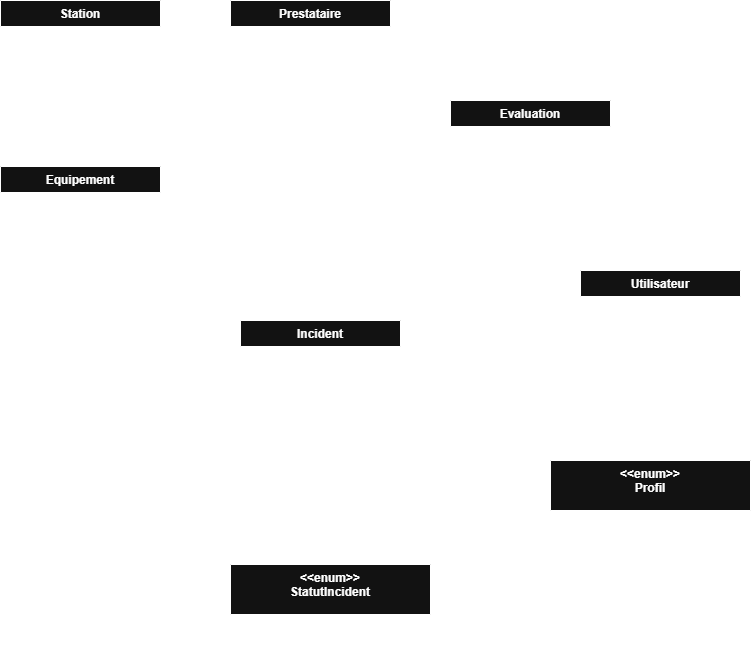

# Journal de bord
## Projet RailWatch - Supervision d’équipements et suivi d’incidents

### Modèle de données
Voici la 1ère version du diagramme de classe avec les principales entités et de leurs relations :

### Schéma d'architecture du projet
*A compléter*

#### Réaprtition des tâches
| Fonctionnalités | Personne en charge | Date de début | Statut |
|-----------------|------------------|---------------|--------|

#### Séance n°1 - 12/10/2026
- Création du dépôt GitHub pour le projet
- 
##### Séance n°2 - 14/10/2026
- Début de la conception du modèle de données et du diagramme de classes
- Création de la BD (MySQL Workbench) et des tables principales
- Création des entités principales
- Création des données de test