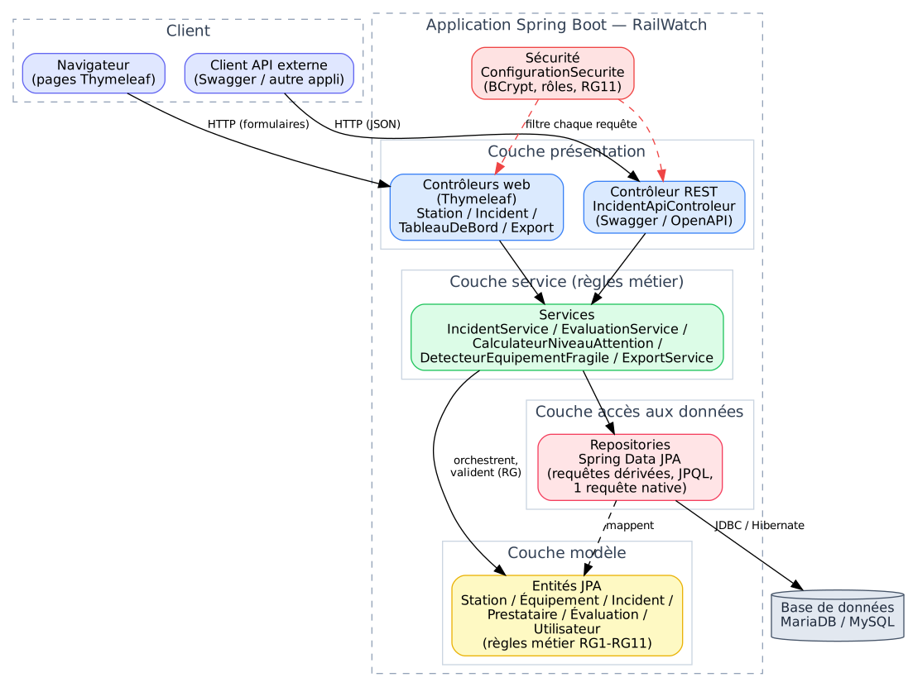

# Journal de bord - RailWatch (ALTN72, 2026-27)
## Projet RailWatch - Supervision d'équipements et suivi d'incidents

**Groupe :** Maëlle BITSINDOU, Alexandre POISSONNEAU

## README

- Prérequis : Java 21, MariaDB. Maven n'a pas besoin d'être installé : le projet contient le Maven Wrapper (`mvnw`).
- Configuration : copier `application-local.properties.example` en `application-local.properties` (ignoré par Git) et renseigner l'identifiant et le mot de passe de sa propre base locale. Les valeurs peuvent aussi venir des variables d'environnement `DB_URL`, `DB_USERNAME` et `DB_PASSWORD`. Chaque personne qui clone le dépôt crée son propre fichier local : aucun secret n'est versionné ni partagé entre les membres du groupe.
- Initialiser la base : `db/create.sql` crée la base `railwatch`. Les tables sont ensuite créées par Hibernate (`spring.jpa.hibernate.ddl-auto`, valeur `create` par défaut) et remplies au démarrage par `DonneesDemonstration` (`railwatch.donnees-demo=true`). Les dates des incidents sont calculées par rapport à l'instant de démarrage (2 h, 47 h, 48 h, 60 h, 72 h, 120 h…), donc les cas limites des indicateurs restent visibles quel que soit le jour.
- Compiler : `./mvnw compile` (Linux, macOS, Git Bash) ou `mvnw.cmd compile` (Windows)
- Lancer : `./mvnw spring-boot:run` puis ouvrir http://localhost:8080
- Tests : `./mvnw verify`
- Application déployée : https://railwatch.spaece.fr/connexion
- Comptes de test : profil 1 `responsable` / `password` (Maëlle, responsable d'exploitation) ; profil 2 `agent` / `password` (Alexandre, agent de signalement).
- Limites connues :
  - Pas de mesure chiffrée de la couverture de tests (JaCoCo non configuré, faute de temps).
  - Le calcul du badge « Équipement fragile » sur le tableau de bord fait un appel par incident actif plutôt
    qu'une requête groupée : suffisant pour le volume de données du projet, mais à revoir pour passer à l'échelle.
  - Pas de pagination sur l'historique ni le tableau de bord : tous les incidents sont chargés en une fois.
  - Pas de responsive/mobile vérifié : l'interface est pensée pour un usage bureau (poste de supervision).
  - `spring.jpa.hibernate.ddl-auto=create` recrée le schéma à chaque démarrage de l'application en
    développement : pratique pour la démo, mais à changer (`validate` ou migration Flyway/Liquibase) avant
    tout usage réel en production.

## ARCHITECTURE

- Dépôt : https://github.com/Maelle26/ALTN72_Supervision_RailWatch
- Schéma :

Architecture en couches classique : les contrôleurs web (Thymeleaf) et le contrôleur REST partagent la même
couche service, qui orchestre les entités (où vivent les règles métier RG1-RG11) et s'appuie sur les
repositories Spring Data JPA pour accéder à la base. La sécurité (`ConfigurationSecurite`) filtre toutes les
requêtes entrantes, qu'elles viennent du navigateur ou d'un client API.

### Modèle de données

Voici la 1ère version du diagramme de classes avec les principales entités et leurs relations :

Relations principales :
- une **Station** contient plusieurs **Équipements**
- un **Équipement** peut avoir plusieurs **Incidents**
- un **Incident** peut être affecté à un **Prestataire** et avoir au plus une **Évaluation**
- un **Utilisateur** possède un **Profil** (Responsable d'exploitation ou Agent de signalement)

### Organisation des packages

| Package | Rôle |
|---|---|
| `modele` | Entités JPA et énumérations (`Statut`, `NiveauAttention`, `TypeEquipement`, `EtatFonctionnement`, `Profil`). Les règles métier propres à une entité y vivent (RG1, RG5, RG8, RG9) |
| `repository` | Accès aux données (Spring Data JPA) : requêtes dérivées, JPQL, une requête native |
| `service` | Règles qui impliquent plusieurs entités : calcul du niveau d'attention (RG3, RG4), cycle de vie des incidents, évaluations, tableau de bord |
| `securite` | Connexion, BCrypt, restrictions par profil (RG11) |
| `api` | API REST (F12), DTO et gestion des exceptions de l'API |
| `controleur` | Contrôleurs Thymeleaf : connexion, stations, équipements, incidents, tableau de bord, historique |
| `exception` | Exceptions personnalisées (`RegleMetierException`, `RessourceIntrouvableException`) |
| `config` | Configuration transverse (`HorlogeConfig`, `DonneesDemonstration`) |

### Maquettes

Les maquettes ont été réalisées dans Figma avant le développement du front :
https://www.figma.com/design/UoQ4ONwVs6sLtQbRdaSzZj

Charte : violet pour la barre de navigation et les actions principales, turquoise, orange et rose pour les autres actions, et quatre pastilles d'état (vert, orange, rouge, bleu « pris en charge »).

| Écran | Fonctionnalités | Accès |
|---|---|---|
| 1. Connexion | F1 | Tous |
| 2. Équipements par station | F2 | Les deux profils |
| 3. Fiche équipement et incidents | F3 | Les deux profils |
| 4. Déclarer un incident | F4 | Les deux profils |
| 5. Détail d'un incident (affecter, résoudre, évaluer) | F5, F7, F8, F10 | Consultation pour les deux profils, actions réservées au responsable |
| 6. Tableau de bord des incidents actifs | F11 | Responsable seul |
| 7. Historique des incidents résolus | F9, F10 | Les deux profils (lecture) |

Le bandeau « Bonjour [Prénom] ([profil]) | Déconnectez-vous » est présent en haut à droite de chaque écran (F1). Le front Thymeleaf reprend cette charte (fichier `railwatch.css`).

## TESTS

- Stratégie : tests unitaires de la couche métier, sans base de données. Une horloge fixe (`Clock.fixed`) est injectée pour tester les seuils horaires sans dépendre de l'heure réelle. Les repositories sont simulés avec Mockito.
- Commande : `./mvnw verify` (ou `./mvnw test`)
- Résultat actuel : `BUILD SUCCESS`, tous les tests passent.
- Couvert :
  - RG3 : 47 h vert, 48 h pile orange, 71 h orange, 72 h pile rouge
  - RG4 : un incident affecté ne porte jamais vert, orange ou rouge (état « pris en charge »)
  - RG5 : un incident résolu ne peut plus être affecté ; résolution avec date et statut
  - RG8 : évaluation refusée si l'incident n'est pas résolu, déjà évalué, ou si la note n'est pas entre 1 et 5
  - RG1 : un incident déclaré est ouvert, sans prestataire, à l'heure courante
  - Tableau de bord : filtre par niveau d'attention
  - Incident inexistant : exception de ressource introuvable (404 côté API)
  - Export CSV de l'historique (`ExportControleurTest`, test d'intégration `@SpringBootTest`, appel HTTP réel via `java.net.http.HttpClient`) : réponse `200`, en-tête `Content-Disposition` de téléchargement et contenu CSV exact renvoyés par le contrôleur
- Non couvert : tests `@DataJpaTest` sur les repositories ; pages Thymeleaf. Pas de mesure chiffrée de la
  couverture

## CHOIX TECHNIQUES

### Droits par profil

Profil 1 : **Responsable d'exploitation** · Profil 2 : **Agent de signalement**

| N° | Fonctionnalité | Responsable d'exploitation | Agent de signalement |
|---|---|---|---|
| F2–F3 | Consulter équipements et fiches | Accès complet | Accès complet |
| F4 | Déclarer un incident | Accès complet | Accès complet |
| F5–F6 | Consulter / modifier un incident | Accès complet (description modifiable tant que l'incident n'est pas résolu) | Lecture seule |
| F7 | Affecter ou réaffecter un prestataire | Accès complet | Interdit |
| F8 | Déclarer un incident résolu | Accès complet | Interdit |
| F9 | Consulter l'historique | Accès complet | Lecture seule |
| F10 | Évaluer un prestataire | Accès complet | Interdit |
| F11 | Tableau de bord | Accès complet | Interdit |

Les restrictions sont appliquées côté serveur dans `ConfigurationSecurite` (règles par URL et par méthode HTTP, RG11). Masquer un bouton dans l'interface n'est qu'un confort d'affichage, jamais la protection : le front masque aussi les actions non autorisées (attribut `estResponsable` injecté dans toutes les vues), mais toute tentative directe d'accès est bloquée par Spring Security et redirigée vers une page « Accès refusé ».

### Exceptions

- Exceptions personnalisées avec messages en français : `RegleMetierException` (règle de gestion violée, levée par les entités) et `RessourceIntrouvableException` (identifiant inconnu, levée par les services).
- Choix : **`@RestControllerAdvice`** pour l'API (`GestionnaireExceptionsApi`), plutôt que `ResponseStatusException` dans les contrôleurs. Les traductions exception → code HTTP (404 ressource inexistante, 422 règle de gestion violée, 400 requête invalide) sont centralisées à un seul endroit. Les entités et les services restent indépendants de HTTP.
- Pour les pages web : un `@ControllerAdvice` dédié (`GestionnaireExceptionsWeb`) gère les mêmes exceptions différemment : une `RegleMetierException` redirige l'utilisateur vers la page d'où il vient avec un message d'erreur affiché en rouge (attribut flash), et une `RessourceIntrouvableException` affiche une page d'erreur sobre, sans trace technique (`server.error.include-stacktrace=never`).

### SOLID

- **Responsabilité unique (appliqué)** : chaque classe a une seule raison de changer. `CalculateurNiveauAttention` ne calcule que le niveau d'attention, avec les seuils de 48 h et 72 h en constantes nommées. Les règles d'une entité sont dans l'entité (`Incident.affecter`, `Incident.resoudre`, constructeur d'`Evaluation`). Les services orchestrent plusieurs entités et des repositories.
- **Inversion des dépendances (appliqué)** : les services reçoivent leurs dépendances par le constructeur, dont l'horloge (`Clock`, bean défini dans `HorlogeConfig`). Les tests injectent une horloge fixe pour vérifier les seuils sans appeler `LocalDateTime.now()`.
- **Ouvert/fermé ** : ce principe prend son sens quand on doit ajouter des
  variantes de comportement sans modifier le code existant (ex. plusieurs stratégies interchangeables). Le
  projet n'a qu'une seule façon de calculer un niveau d'attention, un seul type de règle métier, une seule
  façon de détecter un équipement fragile : il n'y a pas de famille de comportements à faire varier, donc pas
  d'abstraction à extraire pour « fermer » le code à la modification. Ajouter ce principe ici aurait
  introduit une interface et une indirection sans bénéfice réel (sur-ingénierie).
- **Substitution de Liskov** : ce principe concerne le remplacement d'une classe mère par
  une sous-classe sans casser le programme. Le projet n'a aucune hiérarchie d'héritage métier (pas de classe
  `Equipement` étendue par `Ascenseur`/`Escalier`, par exemple : le type d'équipement est un simple attribut
  `TypeEquipement`, une énumération, pas une hiérarchie de classes). Il n'y a donc rien à substituer.
- **Ségrégation des interfaces** : ce principe évite de forcer une classe à implémenter des
  méthodes dont elle n'a pas besoin, à cause d'une interface trop large. Le projet n'a qu'une seule interface
  « métier », `UserDetailsService` (Spring Security, implémentée par `ServiceUtilisateurs`), qui expose une
  seule méthode : il n'y a pas d'interface volumineuse à découper ici.

### Requête SQL native

- Où : `EvaluationRepository.calculerNoteMoyenne` (note moyenne d'un prestataire, avec jointure entre `evaluation` et `incident`).
- Analyse critique :
  - **Inconvénients** : la requête native est liée au schéma physique (noms de colonnes `id_incident`,
    `id_prestataire` écrits en dur) et non aux entités JPA : un renommage de colonne la casse silencieusement,
    sans erreur de compilation ni même de démarrage (elle n'est vérifiée qu'à l'exécution, au premier appel).
    Elle est aussi moins portable : écrite pour la syntaxe MySQL/MariaDB, elle devrait être adaptée pour un
    autre SGBD.
  - **Avantages** : en contrepartie, le calcul (`AVG`) est fait par la base de données elle-même, sans
    charger toutes les lignes `Evaluation` en mémoire côté application pour les moyenner à la main - plus
    efficace dès que le volume d'évaluations grandit.
  - **Alternative** : le même résultat est exprimable en JPQL portable, par exemple
    `SELECT AVG(e.note) FROM Evaluation e WHERE e.incident.prestataire.id = :idPrestataire`, qui aurait
    l'avantage d'être vérifié à la compilation et indépendant du SGBD.
  - La requête native est malgré tout utilisée ici parce que le sujet impose explicitement qu'au moins une
    requête du projet soit native.

### @Transactional

- Les services sont en `@Transactional(readOnly = true)` par défaut : ils ne font que lire.
- Les méthodes qui modifient des données sont annotées `@Transactional` : `declarer`, `modifierDescription`, `affecter`, `resoudre` et `evaluer` (RG10 : toute erreur annule l'opération). `DonneesDemonstration.run` est aussi transactionnelle : tout ou rien.

## LOT ALPHA

### Fonctionnalité transverse 1 : Qualité renforcée (piste 7)

- Besoin : détecter les régressions sur les règles de gestion.
- Périmètre envisagé : tests unitaires (réalisés), tests d'intégration des repositories et des contrôleurs, mesure de la couverture (JaCoCo).
- Choix et essais : tests unitaires Mockito/AssertJ sur les services (`CalculateurNiveauAttentionTest`, `IncidentServiceTest`, `EvaluationServiceTest`), complétés par un test d'intégration `ExportControleurTest` qui démarre l'application complète (`@SpringBootTest`, comme `TpFilRougeApplicationTests`) et appelle réellement la route via le client HTTP du JDK (`java.net.http.HttpClient`) : il vérifie le dispatch HTTP réel (authentification, statut, en-têtes de réponse, corps exact du fichier téléchargé), au-delà des tests unitaires.
- Ce qui fonctionne : les règles métier (RG3, RG5, RG8, RG10...) sont couvertes par les tests unitaires ; la route d'export est couverte par un test d'intégration qui vérifie l'authentification, le type de contenu et le corps de la réponse.
- Difficultés : exécuter l'application réellement pour valider manuellement (MariaDB local, dialecte Hibernate) ; pas de mesure de couverture chiffrée faute de temps pour configurer JaCoCo.

### Fonctionnalité transverse 2 : Export CSV de l'historique (piste 9)

- Besoin : permettre au responsable d'exploitation de récupérer l'historique des incidents résolus hors de l'application (tableur, archivage, reporting).
- Périmètre envisagé : un bouton de téléchargement sur la page `/historique`, qui génère un fichier `.csv` avec une ligne par incident résolu (date de résolution, station, équipement, description, prestataire, durée en heures, note, commentaire).
- Choix et essais : génération du CSV dans un service dédié (`ExportService`), séparé du contrôleur (`ExportControleur`, route `GET /historique/export`) pour rester testable sans servlet. Séparateur `;` choisi plutôt que `,` car Excel en version française utilise la virgule comme séparateur décimal, ce qui casserait l'alignement des colonnes avec un CSV séparé par des virgules. Un BOM UTF-8 est ajouté en tête de fichier pour que les accents s'affichent correctement à l'ouverture dans Excel. Les champs texte sont échappés (guillemets doublés) s'ils contiennent le séparateur, un guillemet ou un retour à la ligne.
- Ce qui fonctionne : le bouton n'apparaît que si l'historique n'est pas vide ; la route réutilise `IncidentService.historique()` (même source de données que la page) ; un test d'intégration (`@SpringBootTest`, appel HTTP réel) vérifie l'en-tête `Content-Disposition` (téléchargement nommé), le type `text/csv` et le contenu du fichier.
- Difficultés : choisir un format lisible à la fois par Excel français et par un parseur CSV standard (d'où le choix du séparateur `;` et du BOM).

## Évolution séance finale

Évolution « Équipement fragile » : un équipement est dit **fragile**
s'il a eu au moins 3 incidents ouverts durant les 30 derniers jours, quel que soit leur statut (EF1-EF3).

### Description et localisation dans le code

- `service/DetecteurEquipementFragile.java` (nouveau) : composant dédié qui porte toute la règle.
  - `SEUIL_INCIDENTS = 3` et `FENETRE = Duration.ofDays(30)` sont les deux seules constantes définissant
    la règle (EF5) ; tout le reste du code les référence, aucune valeur n'est redupliquée ailleurs.
  - `estFragile(Equipement)` et `compterIncidentsRecents(Equipement)` recalculent systématiquement le
    résultat à partir de l'horloge injectée (`Clock`), sans jamais rien stocker en base (EF4). La règle vit
    ici, dans la couche service, jamais dans un contrôleur ou une vue (EF6).
- `repository/IncidentRepository.java` : ajout de la requête dérivée
  `countByEquipementIdAndDateHeureOuvertureGreaterThanEqual`, qui compte tous les incidents d'un équipement
  dont la date d'ouverture est postérieure ou égale à la date pivot, sans filtrer par statut (EF2).
- `service/IncidentActif.java` : ajout du champ `equipementFragile`, calculé une seule fois par
  `IncidentService.enActif(...)`, pour que le tableau de bord n'ait pas à relancer la règle lui-même.
- `controleur/StationControleur.java` (`ficheEquipement`) : ajoute l'attribut `fragile` au modèle de la
  fiche équipement.
- `controleur/IncidentControleur.java` (`declarer`) : après la déclaration, vérifie si l'équipement est
  devenu fragile et adapte le message de confirmation en conséquence.
- `templates/equipement.html` et `templates/tableau-de-bord.html` : badge « Équipement fragile » affiché
  respectivement sur la fiche équipement et sur chaque ligne d'incident actif dont l'équipement est fragile.
- `static/css/railwatch.css` : classe `.pastille.fragile` pour le style du badge.
- `config/DonneesDemonstration.java` : deux incidents supplémentaires ajoutés sur `portiqueGare` (qui en
  avait déjà un) pour que cet équipement soit fragile dès le démarrage, et permettre de voir le badge
  immédiatement sans avoir à déclarer 3 incidents à la main.

### Choix de conception et raccourcis

- Le comptage est fait par une **requête dérivée Spring Data** (`countBy...GreaterThanEqual`) plutôt qu'en
  itérant en mémoire sur `equipement.getIncidents()` : plus proche de la base, évite de charger tous les
  incidents d'un équipement juste pour les compter, et l'opérateur `>=` correspond exactement à l'énoncé
  (EF1 : « postérieure ou égale à »).
- `equipementFragile` est calculé pour **tous** les incidents actifs du tableau de bord (un appel repository
  par incident actif). Pour le volume de données de ce projet (quelques dizaines d'incidents), c'est largement
  suffisant ; sur un plus gros volume, il faudrait une requête groupée (comptage par équipement en un seul
  aller-retour) plutôt qu'un appel par ligne. C'est le raccourci assumé de cette évolution, faute de temps.
- Le badge réutilise la classe CSS `.pastille` déjà existante (même famille visuelle que les pastilles de
  niveau/état), avec une couleur distincte (`#881337`), plutôt que de créer un nouveau composant visuel.

### Tests ajoutés et limites connues

- `DetecteurEquipementFragileTest` (nouveau, tests unitaires Mockito) : vérifie qu'en dessous de 3 incidents
  l'équipement n'est pas fragile, qu'à partir de 3 il l'est, que le statut des incidents n'intervient pas
  dans le comptage (EF2), que la date pivot transmise au repository est bien *maintenant − 30 jours* (EF1,
  EF4), et que le seuil/la fenêtre sont bien les constantes publiques uniques de la classe (EF5).
- **Limite connue** : le comportement exact aux bornes dépend
  de la traduction SQL du mot-clé Spring Data `GreaterThanEqual` (`>=`), qui n'est pas revérifiée ici avec un
  test d'intégration sur une vraie base (`@DataJpaTest`) faute de temps ; elle est exigée implicitement par
  le nom de la méthode et par la documentation Spring Data, mais pas explicitement rejouée avec les dates
  exactes de l'énoncé.
- Pas de test de bout en bout (navigateur) sur l'affichage du badge dans les 3 emplacements (fiche
  équipement, tableau de bord, message de déclaration) ; vérifié manuellement en local avec les données de
  démonstration (`portiqueGare`).

## BILAN

- **Contribution de chacun** : Maëlle a réalisé le socle du projet : modèle de données et règles
  métier, couche service, sécurité, API REST, maquettes Figma et front Thymeleaf, tests, les deux
  fonctionnalités du lot alpha et l'évolution « Équipement fragile ». Alexandre a pris en charge le
  déploiement de l'application et la fonctionnalité complémentaire.
- **Plus grande difficulté et comment elle a été surmontée** :L'organisation sur les choix de conception au fur et à mesure (architecture
  en couches, application concrète de SOLID, endroit où placer chaque règle de gestion). La difficulté a été
  surmontée en avançant fonctionnalité par fonctionnalité plutôt qu'en voulant tout mener de front, en
  s'appuyant sur les patterns déjà en place dans le code existant (RG1-RG11 déjà réparties entre entités et
  services) pour rester cohérente en ajoutant les suivantes, et en prenant le temps de vérifier chaque
  nouvelle règle avec des tests plutôt que de supposer qu'elle fonctionnait.
- **Fonctionnalités non réalisées et pourquoi** : pas de mesure chiffrée de la couverture de tests, pas de tests `@DataJpaTest` sur les repositories, pas de pagination sur l'historique et le
  tableau de bord, interface non vérifiée en mobile/responsive - toutes écartées faute de temps face à la
  deadline, en priorisant les fonctionnalités demandées par le sujet (F1-F12, lot alpha, évolution finale)
  sur ces aspects de confort/robustesse supplémentaires.
- **Trois points à retenir du cours et du projet** :
  1. Injecter une dépendance comme l'horloge (`Clock`) plutôt que d'appeler `LocalDateTime.now()` directement
     rend du code autrement difficile à tester (seuils de 48 h/72 h, fenêtre de 30 jours) parfaitement
     testable de façon déterministe, sans attendre ni simuler le temps qui passe.
  2. La sécurité côté serveur (RG11) n'est pas négociable : masquer un bouton dans l'interface n'est qu'un
     confort d'affichage, jamais une protection réelle - c'est `ConfigurationSecurite` qui est utilisée.
  3. Une architecture en couches bien respectée dès le départ (entités pour les règles locales, services pour
     l'orchestration, repositories pour l'accès aux données) rend les évolutions tardives, comme
     « Équipement fragile » ajoutée en fin de projet, beaucoup plus simples à intégrer proprement sans toucher
     au reste du code.

## Journal des séances

### Séance n°1 - 12/10/2026
- Création du dépôt GitHub pour le projet
- Ajout du `.gitignore` (dossier target, configuration IntelliJ, fichiers de secrets)

### Séance n°2 - 14/10/2026
- Début de la conception du modèle de données et du diagramme de classes
- Création de la BD (MySQL Workbench) et des tables principales
- Création des entités principales
- Création des données de test
- Suppression de l'exemple « Programmeur » issu du TP

### Séance n°3 - 30/10/2026
- Ajout des relations JPA entre les entités (Station, Équipement, Incident, Prestataire, Évaluation)
- Passage des dates de `String` à `LocalDateTime` pour pouvoir calculer la durée d'ouverture d'un incident
- Création des enums `TypeEquipement` et `EtatFonctionnement`, stockés en texte en base (`@Enumerated(EnumType.STRING)`)
- Règles métier placées dans les entités :
  - RG1 : un incident démarre sans prestataire
  - RG5 : un incident résolu ne peut plus être affecté ni modifié, la résolution ne peut pas précéder l'ouverture
  - RG8 : une seule évaluation par incident, uniquement si l'incident est résolu et affecté, note de 1 à 5
  - RG9 : référence d'équipement unique
- Création de l'exception personnalisée `RegleMetierException`
- Correction de `IncidentRepository` (doublon, type de l'identifiant, noms des champs dans les requêtes)
- Regroupement des repositories dans un package `repository` séparé du modèle

### 05/11/2026
- Maquettes Figma des 7 écrans (voir ARCHITECTURE)
- Couche service : `CalculateurNiveauAttention` (seuils en constantes, horloge injectée), `IncidentService`, `EvaluationService`
- Sécurité : connexion par formulaire, BCrypt, restrictions par profil côté serveur
- API REST des incidents, documentée avec Swagger
- Tests unitaires de la couche métier (`BUILD SUCCESS`)
- Front Thymeleaf complet : connexion, stations, fiche équipement, déclaration, détail d'incident (affectation, résolution, évaluation), tableau de bord, historique
- Gestion des erreurs côté pages web (`GestionnaireExceptionsWeb`)
- Vérification de la connexion avec les deux profils de test
  - Lot alpha, fonctionnalité 2 : export CSV de l'historique des incidents résolus (`ExportService`, `ExportControleur`, bouton sur la page historique), avec test d'intégration `@SpringBootTest`