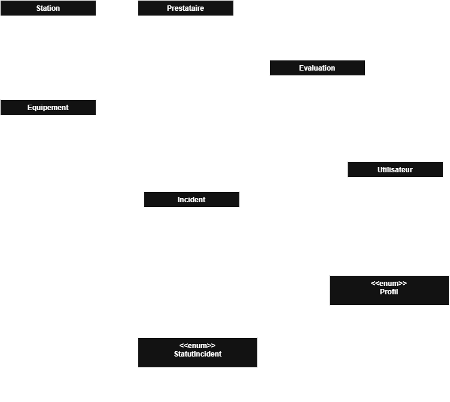

# Journal de bord — RailWatch (ALTN72, 2026-27)
## Projet RailWatch - Supervision d'équipements et suivi d'incidents

**Groupe :** Maëlle BITSINDOU, Alexandre POISSONNEAU

## README

- Prérequis : Java 21, MariaDB. Maven n'a pas besoin d'être installé : le projet contient le Maven Wrapper (`mvnw`).
- Configuration : copier `application-local.properties.example` en `application-local.properties` (ignoré par Git) et renseigner l'identifiant et le mot de passe de sa propre base locale. Les valeurs peuvent aussi venir des variables d'environnement `DB_URL`, `DB_USERNAME` et `DB_PASSWORD`. Chaque personne qui clone le dépôt crée son propre fichier local : aucun secret n'est versionné ni partagé entre les membres du groupe.
- Initialiser la base : `db/create.sql` crée la base `railwatch`. Les tables sont ensuite créées par Hibernate (`spring.jpa.hibernate.ddl-auto`, valeur `create` par défaut) et remplies au démarrage par `DonneesDemonstration` (`railwatch.donnees-demo=true`). Les dates des incidents sont calculées par rapport à l'instant de démarrage (2 h, 47 h, 48 h, 60 h, 72 h, 120 h…), donc les cas limites des indicateurs restent visibles quel que soit le jour.
- Compiler : `./mvnw compile` (Linux, macOS, Git Bash) ou `mvnw.cmd compile` (Windows)
- Lancer : `./mvnw spring-boot:run` puis ouvrir http://localhost:8080
- Tests : `./mvnw verify`
- Application déployée : **À COMPLÉTER**
- Comptes de test : profil 1 `responsable` / `password` (Maëlle, responsable d'exploitation) ; profil 2 `agent` / `password` (Alexandre, agent de signalement).
- Limites connues : **À COMPLÉTER en fin de projet**

## ARCHITECTURE

- Dépôt : https://github.com/Maelle26/ALTN72_Supervision_RailWatch
- Schéma : **À COMPLÉTER** (schéma d'architecture à exporter en `docs/architecture.png`)

### Modèle de données

Voici la 1ère version du diagramme de classes avec les principales entités et leurs relations :

Relations principales :
- une **Station** contient plusieurs **Équipements**
- un **Équipement** peut avoir plusieurs **Incidents**
- un **Incident** peut être affecté à un **Prestataire** et avoir au plus une **Évaluation**
- un **Utilisateur** possède un **Profil** (Responsable d'exploitation ou Agent de signalement)

### Organisation des packages

| Package | Rôle |
|---|---|
| `modele` | Entités JPA et énumérations (`Statut`, `NiveauAttention`, `TypeEquipement`, `EtatFonctionnement`, `Profil`). Les règles métier propres à une entité y vivent (RG1, RG5, RG8, RG9) |
| `repository` | Accès aux données (Spring Data JPA) : requêtes dérivées, JPQL, une requête native |
| `service` | Règles qui impliquent plusieurs entités : calcul du niveau d'attention (RG3, RG4), cycle de vie des incidents, évaluations, tableau de bord |
| `securite` | Connexion, BCrypt, restrictions par profil (RG11) |
| `api` | API REST (F12), DTO et gestion des exceptions de l'API |
| `controleur` | Contrôleurs Thymeleaf : connexion, stations, équipements, incidents, tableau de bord, historique |
| `exception` | Exceptions personnalisées (`RegleMetierException`, `RessourceIntrouvableException`) |
| `config` | Configuration transverse (`HorlogeConfig`, `DonneesDemonstration`) |

### Maquettes

Les maquettes ont été réalisées dans Figma avant le développement du front :
https://www.figma.com/design/UoQ4ONwVs6sLtQbRdaSzZj

Charte : violet pour la barre de navigation et les actions principales, turquoise, orange et rose pour les autres actions, et quatre pastilles d'état (vert, orange, rouge, bleu « pris en charge »).

| Écran | Fonctionnalités | Accès |
|---|---|---|
| 1. Connexion | F1 | Tous |
| 2. Équipements par station | F2 | Les deux profils |
| 3. Fiche équipement et incidents | F3 | Les deux profils |
| 4. Déclarer un incident | F4 | Les deux profils |
| 5. Détail d'un incident (affecter, résoudre, évaluer) | F5, F7, F8, F10 | Consultation pour les deux profils, actions réservées au responsable |
| 6. Tableau de bord des incidents actifs | F11 | Responsable seul |
| 7. Historique des incidents résolus | F9, F10 | Les deux profils (lecture) |

Le bandeau « Bonjour [Prénom] ([profil]) | Déconnectez-vous » est présent en haut à droite de chaque écran (F1). Le front Thymeleaf reprend cette charte (fichier `railwatch.css`).

## TESTS

- Stratégie : tests unitaires de la couche métier, sans base de données. Une horloge fixe (`Clock.fixed`) est injectée pour tester les seuils horaires sans dépendre de l'heure réelle. Les repositories sont simulés avec Mockito.
- Commande : `./mvnw verify` (ou `./mvnw test`)
- Résultat actuel : `BUILD SUCCESS`, tous les tests passent.
- Couvert :
  - RG3 : 47 h vert, 48 h pile orange, 71 h orange, 72 h pile rouge
  - RG4 : un incident affecté ne porte jamais vert, orange ou rouge (état « pris en charge »)
  - RG5 : un incident résolu ne peut plus être affecté ; résolution avec date et statut
  - RG8 : évaluation refusée si l'incident n'est pas résolu, déjà évalué, ou si la note n'est pas entre 1 et 5
  - RG1 : un incident déclaré est ouvert, sans prestataire, à l'heure courante
  - Tableau de bord : filtre par niveau d'attention
  - Incident inexistant : exception de ressource introuvable (404 côté API)
  - Export CSV de l'historique (`ExportControleurTest`, test d'intégration `@SpringBootTest`, appel HTTP réel via `java.net.http.HttpClient`) : réponse `200`, en-tête `Content-Disposition` de téléchargement et contenu CSV exact renvoyés par le contrôleur
- Non couvert (pour l'instant) : tests `@DataJpaTest` sur les repositories ; pages Thymeleaf. **À COMPLÉTER** avec la couverture mesurée (JaCoCo).

## CHOIX TECHNIQUES

### Droits par profil

Profil 1 : **Responsable d'exploitation** · Profil 2 : **Agent de signalement**

| N° | Fonctionnalité | Responsable d'exploitation | Agent de signalement |
|---|---|---|---|
| F2–F3 | Consulter équipements et fiches | Accès complet | Accès complet |
| F4 | Déclarer un incident | Accès complet | Accès complet |
| F5–F6 | Consulter / modifier un incident | Accès complet (description modifiable tant que l'incident n'est pas résolu) | Lecture seule |
| F7 | Affecter ou réaffecter un prestataire | Accès complet | Interdit |
| F8 | Déclarer un incident résolu | Accès complet | Interdit |
| F9 | Consulter l'historique | Accès complet | Lecture seule |
| F10 | Évaluer un prestataire | Accès complet | Interdit |
| F11 | Tableau de bord | Accès complet | Interdit |

Les restrictions sont appliquées côté serveur dans `ConfigurationSecurite` (règles par URL et par méthode HTTP, RG11). Masquer un bouton dans l'interface n'est qu'un confort d'affichage, jamais la protection : le front masque aussi les actions non autorisées (attribut `estResponsable` injecté dans toutes les vues), mais toute tentative directe d'accès est bloquée par Spring Security et redirigée vers une page « Accès refusé ».

### Exceptions

- Exceptions personnalisées avec messages en français : `RegleMetierException` (règle de gestion violée, levée par les entités) et `RessourceIntrouvableException` (identifiant inconnu, levée par les services).
- Choix : **`@RestControllerAdvice`** pour l'API (`GestionnaireExceptionsApi`), plutôt que `ResponseStatusException` dans les contrôleurs. Les traductions exception → code HTTP (404 ressource inexistante, 422 règle de gestion violée, 400 requête invalide) sont centralisées à un seul endroit. Les entités et les services restent indépendants de HTTP.
- Pour les pages web : un `@ControllerAdvice` dédié (`GestionnaireExceptionsWeb`) gère les mêmes exceptions différemment : une `RegleMetierException` redirige l'utilisateur vers la page d'où il vient avec un message d'erreur affiché en rouge (attribut flash), et une `RessourceIntrouvableException` affiche une page d'erreur sobre, sans trace technique (`server.error.include-stacktrace=never`).

### SOLID

- **Responsabilité unique (appliqué)** : chaque classe a une seule raison de changer. `CalculateurNiveauAttention` ne calcule que le niveau d'attention, avec les seuils de 48 h et 72 h en constantes nommées. Les règles d'une entité sont dans l'entité (`Incident.affecter`, `Incident.resoudre`, constructeur d'`Evaluation`). Les services orchestrent plusieurs entités et des repositories.
- **Inversion des dépendances (appliqué)** : les services reçoivent leurs dépendances par le constructeur, dont l'horloge (`Clock`, bean défini dans `HorlogeConfig`). Les tests injectent une horloge fixe pour vérifier les seuils sans appeler `LocalDateTime.now()`.
- Ouvert/fermé, substitution de Liskov, ségrégation des interfaces : **À COMPLÉTER** avec une justification honnête de leur non-pertinence dans ce projet (pas de hiérarchie de types ni d'interface volumineuse à substituer ou à découper).

### Requête SQL native

- Où : `EvaluationRepository.calculerNoteMoyenne` (note moyenne d'un prestataire, avec jointure entre `evaluation` et `incident`).
- Analyse critique : **À COMPLÉTER**. Éléments à discuter : la requête native est liée au schéma (noms de colonnes `id_incident`, `id_prestataire`) et n'est pas vérifiée à la compilation ; moins portable que du JPQL ; en contrepartie, le calcul est fait par la base sans charger toutes les évaluations. Le même résultat est exprimable en JPQL (`select avg(e.note) …`). Elle est utilisée parce que le sujet impose une requête native.

### @Transactional

- Les services sont en `@Transactional(readOnly = true)` par défaut : ils ne font que lire.
- Les méthodes qui modifient des données sont annotées `@Transactional` : `declarer`, `modifierDescription`, `affecter`, `resoudre` et `evaluer` (RG10 : toute erreur annule l'opération). `DonneesDemonstration.run` est aussi transactionnelle : tout ou rien.

## LOT ALPHA

### Fonctionnalité transverse 1 : Qualité renforcée (piste 7)

- Besoin : détecter les régressions sur les règles de gestion.
- Périmètre envisagé : tests unitaires (réalisés), tests d'intégration des repositories et des contrôleurs, mesure de la couverture (JaCoCo).
- Choix et essais : tests unitaires Mockito/AssertJ sur les services (`CalculateurNiveauAttentionTest`, `IncidentServiceTest`, `EvaluationServiceTest`), complétés par un test d'intégration `ExportControleurTest` qui démarre l'application complète (`@SpringBootTest`, comme `TpFilRougeApplicationTests`) et appelle réellement la route via le client HTTP du JDK (`java.net.http.HttpClient`) : il vérifie le dispatch HTTP réel (authentification, statut, en-têtes de réponse, corps exact du fichier téléchargé), au-delà des tests unitaires.
- Ce qui fonctionne : les règles métier (RG3, RG5, RG8, RG10...) sont couvertes par les tests unitaires ; la route d'export est couverte par un test d'intégration qui vérifie l'authentification, le type de contenu et le corps de la réponse.
- Difficultés : exécuter l'application réellement pour valider manuellement (MariaDB local, dialecte Hibernate) ; pas de mesure de couverture chiffrée faute de temps pour configurer JaCoCo.
- Reste à faire : ajouter JaCoCo pour mesurer la couverture, et éventuellement un `@DataJpaTest` sur un repository.

### Fonctionnalité transverse 2 : Export CSV de l'historique (piste 9)

- Besoin : permettre au responsable d'exploitation de récupérer l'historique des incidents résolus hors de l'application (tableur, archivage, reporting).
- Périmètre envisagé : un bouton de téléchargement sur la page `/historique`, qui génère un fichier `.csv` avec une ligne par incident résolu (date de résolution, station, équipement, description, prestataire, durée en heures, note, commentaire).
- Choix et essais : génération du CSV dans un service dédié (`ExportService`), séparé du contrôleur (`ExportControleur`, route `GET /historique/export`) pour rester testable sans servlet. Séparateur `;` choisi plutôt que `,` car Excel en version française utilise la virgule comme séparateur décimal, ce qui casserait l'alignement des colonnes avec un CSV séparé par des virgules. Un BOM UTF-8 est ajouté en tête de fichier pour que les accents s'affichent correctement à l'ouverture dans Excel. Les champs texte sont échappés (guillemets doublés) s'ils contiennent le séparateur, un guillemet ou un retour à la ligne.
- Ce qui fonctionne : le bouton n'apparaît que si l'historique n'est pas vide ; la route réutilise `IncidentService.historique()` (même source de données que la page) ; un test d'intégration (`@SpringBootTest`, appel HTTP réel) vérifie l'en-tête `Content-Disposition` (téléchargement nommé), le type `text/csv` et le contenu du fichier.
- Difficultés : choisir un format lisible à la fois par Excel français et par un parseur CSV standard (d'où le choix du séparateur `;` et du BOM).
- Reste à faire : valider manuellement l'ouverture du fichier dans Excel/LibreOffice avec des données réelles.

## BILAN

- Contribution de chacun : **À COMPLÉTER honnêtement** (qui a réalisé quoi).
- Plus grande difficulté et comment elle a été surmontée : **À COMPLÉTER**
- Fonctionnalités non réalisées et pourquoi : **À COMPLÉTER en fin de projet**
- Trois points à retenir du cours et du projet : **À COMPLÉTER**

## Répartition des tâches

| Fonctionnalités | Personne en charge | Date de début | Statut |
|-----------------|--------------------|---------------|--------|
| Modèle de données et diagramme de classes | Maëlle | 14/10/2026 | Terminé |
| Relations JPA et règles métier dans les entités | Maëlle | 30/10/2026 | Terminé |
| Repositories et requêtes | Maëlle | 30/10/2026 | Terminé |
| Services : niveau d'attention, incidents, évaluations | Maëlle | 05/11/2026 | Terminé, testé |
| Sécurité (connexion, BCrypt, droits par profil) | Maëlle | 05/11/2026 | Terminé, testé |
| API REST et Swagger | Maëlle | 05/11/2026 | Fait, à tester |
| Maquettes Figma | Maëlle | 05/11/2026 | Terminé |
| Front Thymeleaf | Maëlle | 05/11/2026 | Fait, à tester entièrement |
| Déploiement | À définir | | À faire |
| Lot alpha - Qualité renforcée (tests + intégration) | Maëlle | 05/11/2026 | Fait, à compléter (JaCoCo) |
| Lot alpha - Export CSV (piste 9) | Maëlle | 05/11/2026 | Fait, à tester |

## Journal des séances

### Séance n°1 - 12/10/2026
- Création du dépôt GitHub pour le projet
- Ajout du `.gitignore` (dossier target, configuration IntelliJ, fichiers de secrets)

### Séance n°2 - 14/10/2026
- Début de la conception du modèle de données et du diagramme de classes
- Création de la BD (MySQL Workbench) et des tables principales
- Création des entités principales
- Création des données de test
- Suppression de l'exemple « Programmeur » issu du TP

### Séance n°3 - 30/10/2026
- Ajout des relations JPA entre les entités (Station, Équipement, Incident, Prestataire, Évaluation)
- Passage des dates de `String` à `LocalDateTime` pour pouvoir calculer la durée d'ouverture d'un incident
- Création des enums `TypeEquipement` et `EtatFonctionnement`, stockés en texte en base (`@Enumerated(EnumType.STRING)`)
- Règles métier placées dans les entités :
  - RG1 : un incident démarre sans prestataire
  - RG5 : un incident résolu ne peut plus être affecté ni modifié, la résolution ne peut pas précéder l'ouverture
  - RG8 : une seule évaluation par incident, uniquement si l'incident est résolu et affecté, note de 1 à 5
  - RG9 : référence d'équipement unique
- Création de l'exception personnalisée `RegleMetierException`
- Correction de `IncidentRepository` (doublon, type de l'identifiant, noms des champs dans les requêtes)
- Regroupement des repositories dans un package `repository` séparé du modèle

### 05/11/2026
- Maquettes Figma des 7 écrans (voir ARCHITECTURE)
- Couche service : `CalculateurNiveauAttention` (seuils en constantes, horloge injectée), `IncidentService`, `EvaluationService`
- Sécurité : connexion par formulaire, BCrypt, restrictions par profil côté serveur
- API REST des incidents, documentée avec Swagger
- Tests unitaires de la couche métier (`BUILD SUCCESS`)
- Front Thymeleaf complet : connexion, stations, fiche équipement, déclaration, détail d'incident (affectation, résolution, évaluation), tableau de bord, historique
- Gestion des erreurs côté pages web (`GestionnaireExceptionsWeb`)
- Vérification de la connexion avec les deux profils de test
- Lot alpha, fonctionnalité 2 : export CSV de l'historique des incidents résolus (`ExportService`, `ExportControleur`, bouton sur la page historique), avec test d'intégration `@SpringBootTest`